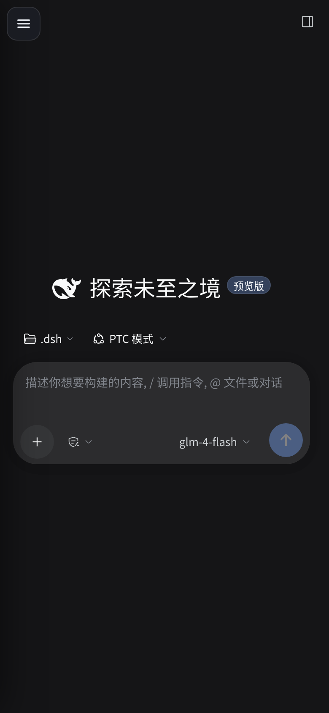
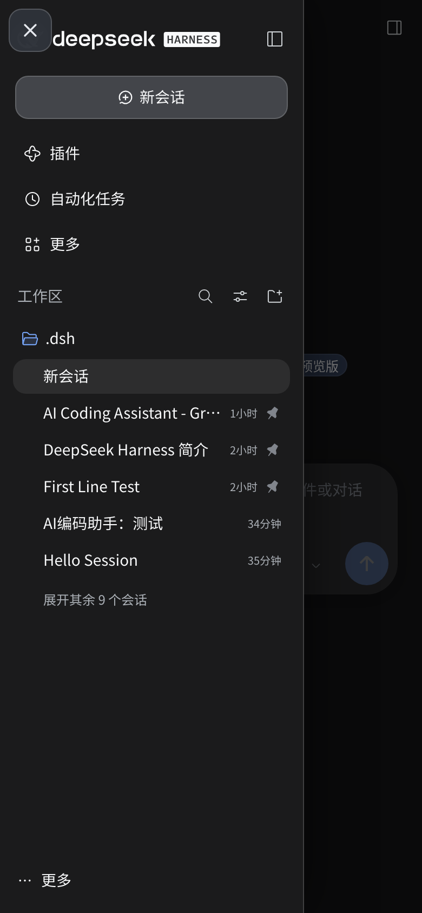

# dsh-plugin-mobile-ux

**DeepSeek Harness 手机端体验插件** — 补上 DSH 在手机上的适配缺口。

纯前端注入，**不改 DSH 源码**；桌面端（>820px）零影响；随时可关、可删。

<p>
  
  
  
</p>

---

## 它解决什么问题

DSH 的 Web 端是按桌面设计的。在 390px 宽的手机上，侧栏常驻占掉 56px，
主内容被压到 334px；面板上的输入控件小于触摸标准；设置弹窗是居中卡片；
部分操作依赖鼠标悬停，触屏根本触发不了。

这个插件把这些问题按「不破坏宿主」的方式补上。

## 功能

| 能力 | 说明 |
|---|---|
| **侧栏抽屉** | 常驻侧栏改为覆盖式抽屉，主内容拿回完整宽度；点一次展开、再点一次收起（按钮同步变成 ✕） |
| **遮罩与手势** | 点遮罩关闭；宽屏（>820px）自动复原，不影响桌面 |
| **阅读排版** | 正文行高 1.78、段落间距、长链接强制断行、代码块与表格横向滚动不撑破屏幕 |
| **输入区适配** | 贴底 + 安全区 + 触摸目标 ≥40px；多行输入时回底按钮自动避让 |
| **回到底部** | 滚动离开底部时出现悬浮按钮，位置跟随输入框高度变化 |
| **设置页全屏** | 手机上设置不再是小卡片，改为全屏 + 顶部标签两列 |
| **移除冗余入口** | 会话页中间那个 ⋯（点开只有插件市场，与侧栏「插件」重复）已隐藏 |
| **字号跟随** | 不写死任何 `font-size`，完全跟随 DSH 自己的字号设置 |
| **逃生开关** | 地址加 `?dshm=off` 即完全不加载本插件，用于对照排查 |

## 安装

### 方式 A：DSH 插件页（推荐，手机就能完成）

1. 打开 DSH → 侧栏 → **插件**
2. 点 **添加插件**
3. 粘贴仓库地址：

```
https://github.com/wond03/dsh-plugin-mobile-ux
```

4. 安装后刷新页面

### 方式 B：命令行

```bash
dsh plugin --profile web add github:wond03/dsh-plugin-mobile-ux
pm2 restart dsh-harness
```

### 方式 C：本地目录

```bash
git clone https://github.com/wond03/dsh-plugin-mobile-ux.git /root/dsh-plugins/dsh-plugin-mobile-ux
```

在 `~/.dsh/profiles/web/cordis.patch.yml` 末尾追加：

```yaml
- insert:
    - id: mobile-ux
      name: "dsh-plugin-mobile-ux"
```

然后 `pm2 restart dsh-harness`。

## 开关与卸载

| 操作 | 方法 |
|---|---|
| 临时关闭（不改任何文件） | 访问 `https://<你的地址>/?dshm=off` |
| 彻底卸载 | 删掉 `cordis.patch.yml` 里的 `mobile-ux` 那一行，重启 |
| 恢复桌面行为 | 窗口宽度 >820px 时插件自动不生效 |

关闭后宿主完全回到原版：没有汉堡按钮、没有遮罩、侧栏回到 56px 常驻。已实测验证。

## 兼容性

- DSH `0.2.1-rc.5`
- iOS Safari 16+ / Android Chrome 110+
- 桌面浏览器：不生效（设计如此）

宿主升级后行为可能变化，已知的宿主模型记录在 [docs/host-model.md](docs/host-model.md)。

## 已知限制

- **会话项操作（置顶/重命名/分叉/归档/复制 ID）在手机上不可达**。宿主把这组按钮放在 `:hover` 才展开的区域（未悬停时 `0×0`），触摸无法触发。这是宿主设计，本插件不介入。
- 底部统计胶囊（`15.6K tok·缓存命中 0%`）在窄屏显示不全，但**点击会展开完整明细**（本轮用量、提供方/模型、未缓存输入、输出），信息不丢失。属宿主设计，不修改。
- 菜单是宿主原生毛玻璃（45% 透明 + 40px 模糊），背后有内容时会透出模糊亮斑，属宿主设计。

## 目录结构

```
lib/client.js            浏览器端全部逻辑（CSS + DOM 增强）
lib/index.js             宿主端空实现（满足插件协议）
docs/host-model.md       宿主模型（布局/字号/层级/红线）— 改代码前必读
host-patches/            对 DSH 安装包做过的改动及回滚方式
deploy/gateway/          可选的 nginx 网关配置（HTTP/2 + 长缓存 + 令牌）
```

## 开发约定

改这个插件前请先读 [docs/host-model.md](docs/host-model.md)。几条硬性红线：

1. 不写 `font-size`，用 `--dsw-font-*` 或继承
2. 不设 `[class*='surface']` / `[class*='panel']` 的 `max-width`
3. `z-index` 只用 900–999
4. 每个 `!important` 必须注释"覆盖谁、为什么"
5. 证据优先：改完用 `?dshm=off` 做对照，用几何数据判断，不靠截图感觉

## License

MIT
